# Orbit

Orbit is a full-stack project management workspace built with the **MERN** stack. It combines a focused user portal for tracking project work with a separate, role-restricted administrator portal for managing people, access, and organization-wide activity.

The application is implemented end to end: React front end, Express REST API, MongoDB persistence, JWT authentication in an HTTP-only cookie, server-side validation, reusable UI components, loading and error states, responsive layouts, and an integration test suite.

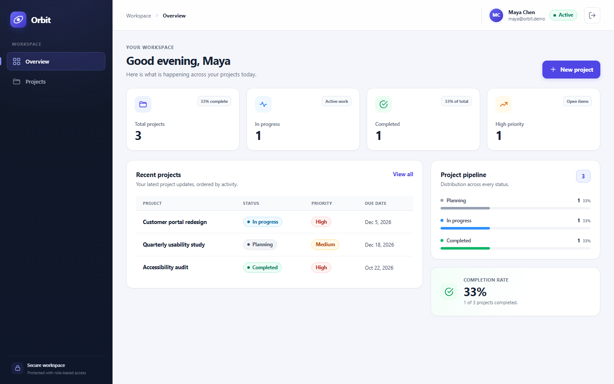

## Highlights

- **User accounts** — registration, login, logout, session restoration, field-level validation, duplicate-email protection, and inactive-account blocking.
- **Separate admin portal** — a dedicated admin login endpoint rejects normal user accounts; the user login endpoint rejects administrator accounts.
- **Role-based access** — `user` and `admin` roles with route guards on the client and authorization middleware on the API.
- **Responsive dashboards** — live statistics loaded from MongoDB, status breakdowns, recent activity, and completion rates.
- **Complete project CRUD** — create, list, search, filter, paginate, view details, edit, and delete with confirmation.
- **Complete user management** — administrators can create users, view account details and project summaries, edit profiles, change roles and status, reset passwords, and delete users.
- **Data integrity** — deleting a user also removes that user's projects; administrators cannot delete, deactivate, or demote their own account.
- **Production-ready details** — HTTP-only cookies, bcrypt password hashing, Helmet, CORS allow-list, rate limiting, centralized API errors, accessible dialogs and form controls, and a mobile navigation drawer.
- **No static application data** — every metric, table, filter, and detail view is served by the API.

## Technology

| Layer | Technology |
| --- | --- |
| Front end | React 18, React Router 6, Vite 6, Axios, custom CSS |
| Back end | Node.js, Express 4, Mongoose 8, JWT, bcryptjs |
| Database | MongoDB (local or MongoDB Atlas) |
| Security | HTTP-only JWT cookie, Helmet, CORS credentials allow-list, express-rate-limit, server-side validation |
| Testing | Node's built-in test runner, Supertest, mongodb-memory-server (or a local test database) |

## Repository structure

```text
orbit/
├── client/                     # React application
│   ├── src/
│   │   ├── assets/             # Global styles and logo
│   │   ├── components/         # Reusable feature and UI components
│   │   │   └── ui/             # Button, Modal, FormControls, Alert, etc.
│   │   ├── context/            # Auth and toast providers
│   │   ├── layouts/            # Auth and dashboard layouts
│   │   ├── pages/              # Login, register, dashboards, projects, users
│   │   ├── routes/             # Route table and access guards
│   │   ├── services/           # Axios client and API service modules
│   │   ├── utils/              # Formatters, constants, API error helpers
│   │   ├── App.jsx
│   │   └── main.jsx
│   ├── index.html
│   └── vite.config.js          # Dev server proxy for /api
├── server/                     # Express API
│   ├── config/                 # MongoDB connection
│   ├── controllers/            # Auth, dashboard, project, admin controllers
│   ├── middleware/             # Auth, admin, rate limiting, error handling
│   ├── models/                 # User and Project Mongoose schemas
│   ├── routes/                 # API route definitions
│   ├── tests/                  # Integration tests
│   ├── utils/                  # Validators, JWT helpers, seed scripts
│   ├── app.js                  # Express application
│   ├── server.js               # Database connection and HTTP startup
│   └── .env.example
├── docs/
│   ├── API.md                  # Full API reference with examples
│   └── DATABASE.md             # Collections, fields, indexes, relationships
├── screenshots/                # Captured application screenshots
├── package.json                # Root convenience scripts
└── README.md
```

## Quick start

### Prerequisites

- Node.js 18 or newer (developed with Node 23)
- npm 9 or newer
- A MongoDB deployment:
  - local `mongod` running on `mongodb://127.0.0.1:27017`, or
  - a MongoDB Atlas connection string

### 1. Install dependencies

```bash
npm install
npm run install:all
```

`npm install` installs the root `concurrently` helper. `install:all` installs the server and client packages.

### 2. Configure the backend

```bash
cd server
cp .env.example .env
```

On Windows PowerShell:

```powershell
Copy-Item server\.env.example server\.env
```

Edit `server/.env` and set at least `MONGODB_URI` and a long, random `JWT_SECRET`.

```dotenv
PORT=5000
NODE_ENV=development
MONGODB_URI=mongodb://127.0.0.1:27017/orbit
JWT_SECRET=replace-with-a-long-random-secret-at-least-32-characters
JWT_EXPIRES_IN=7d
CLIENT_URL=http://localhost:5173

ADMIN_NAME=Orbit Administrator
ADMIN_EMAIL=admin@orbit.app
ADMIN_PASSWORD=Admin@12345
```

**MongoDB Atlas example:**

```dotenv
MONGODB_URI=mongodb+srv://<username>:<password>@<cluster>.mongodb.net/orbit?retryWrites=true&w=majority
```

Keep `server/.env` private. It is ignored by Git; only `.env.example` is committed.

### 3. Create the administrator

```bash
npm run seed:admin --prefix server
```

The script creates the admin from `ADMIN_EMAIL` / `ADMIN_PASSWORD`, or updates that account if it already exists.

### 4. Optional: load demo data

The demo seed is intended for local exploration and screenshots. It creates eight users and fourteen projects and is **never run automatically**.

```bash
npm run seed:demo --prefix server
```

It is safe to re-run: previous demo users and their projects are removed first. Do not run it against production data.

### 5. Start development servers

From the project root:

```bash
npm run dev
```

- React app: <http://localhost:5173>
- API: <http://localhost:5000>
- Health check: <http://localhost:5000/api/health>

Vite proxies `/api` requests to Express, so the browser treats API calls as same-origin and the authentication cookie works without extra CORS configuration.

## Demo credentials

These accounts are created only when you run the seed scripts.

| Portal | Email | Password | Role / status |
| --- | --- | --- | --- |
| Admin | `admin@orbit.app` | `Admin@12345` | Administrator, active |
| User | `maya@orbit.demo` | `User@12345` | User, active |
| User | `daniel@orbit.demo` | `User@12345` | User, active |
| User | `liam@orbit.demo` | `User@12345` | User, inactive (cannot sign in) |

You can also create a normal account from the registration page. New accounts always receive the `user` role.

## Using Orbit

### User portal

1. Register or sign in at `/login`.
2. The overview dashboard shows total, in-progress, completed, and high-priority projects, a pipeline breakdown, and recent activity.
3. Open **Projects** to search, filter by status or priority, paginate, and create projects.
4. Use the eye action to open project details, the pencil action to edit, and the trash action to delete after confirmation.

Users only see and manage their own projects. API ownership checks return `404` for projects belonging to another user.

### Administrator portal

1. Open `/admin/login` and sign in with an administrator account.
2. The admin overview shows total, active, and inactive users, total and completed projects, role counts, status breakdowns, and recent users and projects.
3. Open **Users** to search, filter by role or status, add accounts, view details, edit profiles, change roles or status, reset passwords, and delete users.
4. Open **Projects** to review and manage projects across every user.

Administrators cannot delete their own account, deactivate themselves, or remove their own administrator role. A user account is rejected at the admin login, and an administrator account is rejected at the user login.

## Production build

Build the React app, then run Express. Express serves `client/dist` when it exists.

```bash
npm run build
npm start
```

The app is then available at <http://localhost:5000>. For production:

- set `NODE_ENV=production`
- use a strong `JWT_SECRET`
- set `CLIENT_URL` to the deployed front-end origin (comma-separate multiple origins)
- use HTTPS so the `secure` cookie flag is sent
- store secrets in the hosting provider's environment configuration

## API documentation

The complete endpoint reference, request bodies, status codes, and examples are in [docs/API.md](docs/API.md). Database structure is documented in [docs/DATABASE.md](docs/DATABASE.md).

Quick summary:

| Method | Endpoint | Access |
| --- | --- | --- |
| `GET` | `/api/health` | Public |
| `POST` | `/api/auth/register` | Public |
| `POST` | `/api/auth/login` | Public, normal users |
| `POST` | `/api/auth/admin/login` | Public, administrators |
| `GET` | `/api/auth/me` | Authenticated |
| `POST` | `/api/auth/logout` | Public |
| `GET` | `/api/dashboard` | Authenticated |
| `GET` | `/api/projects` | Authenticated |
| `POST` | `/api/projects` | Authenticated |
| `GET` | `/api/projects/:id` | Owner or admin |
| `PUT` | `/api/projects/:id` | Owner or admin |
| `DELETE` | `/api/projects/:id` | Owner or admin |
| `GET` | `/api/admin/dashboard` | Admin |
| `GET` | `/api/admin/users` | Admin |
| `POST` | `/api/admin/users` | Admin |
| `GET` | `/api/admin/users/:id` | Admin |
| `PUT` | `/api/admin/users/:id` | Admin |
| `DELETE` | `/api/admin/users/:id` | Admin |

### Response shape

Success:

```json
{
  "success": true,
  "message": "Project created successfully.",
  "data": {}
}
```

Error:

```json
{
  "success": false,
  "message": "Please correct the highlighted fields.",
  "errors": {
    "title": "Project title must be at least 2 characters."
  }
}
```

## Authentication

- Passwords are hashed with bcrypt (12 salt rounds) in a Mongoose pre-save hook.
- Successful registration and login set a JWT in the `orbit_token` cookie.
- The cookie is `HttpOnly`, `SameSite=Lax`, `Secure` in production, and expires after seven days.
- The API also accepts `Authorization: Bearer <token>` for non-browser clients.
- Every protected request reloads the user, so deleted or deactivated accounts lose access immediately.
- Login is rate-limited to 25 attempts per 15 minutes; registration to 15 per hour.

## Testing

The integration suite covers registration and validation, duplicate email handling, secure cookies, user/admin portal separation, project CRUD and ownership isolation, admin authorization, dynamic dashboards, user management, self-protection rules, cascade deletion, and logout.

```bash
npm test
```

By default the suite uses `mongodb-memory-server`. On the first run that package downloads a MongoDB binary, which may take several minutes depending on the network.

To use an existing local MongoDB instead, point the suite at a **dedicated test database**:

```powershell
# PowerShell
$env:TEST_MONGODB_URI="mongodb://127.0.0.1:27017/orbit_test"
npm test
```

```bash
# Bash
TEST_MONGODB_URI="mongodb://127.0.0.1:27017/orbit_test" npm test
```

> The test suite calls `dropDatabase()` on the configured test connection. Never point `TEST_MONGODB_URI` at development or production data.

Verified result for this submission:

```text
tests 7
pass 7
fail 0
```

The front-end production build was also verified with `npm run build`.

## Database

Two collections are used:

- `users` — name, unique lowercase email, bcrypt password hash, role (`user` / `admin`), status (`active` / `inactive`), last login timestamp, timestamps.
- `projects` — title, description, status (`planning` / `in-progress` / `completed`), priority (`low` / `medium` / `high`), optional due date, owner reference, timestamps.

Indexes include unique email, project owner, status/priority, creation date, and a text index on project title and description. See [docs/DATABASE.md](docs/DATABASE.md) for full schema details and sample documents.

## Screenshots

All screenshots were captured from the running application backed by a local MongoDB database populated with the demo seed.

### Authentication

| User login | Registration | Admin login |
| --- | --- | --- |
| 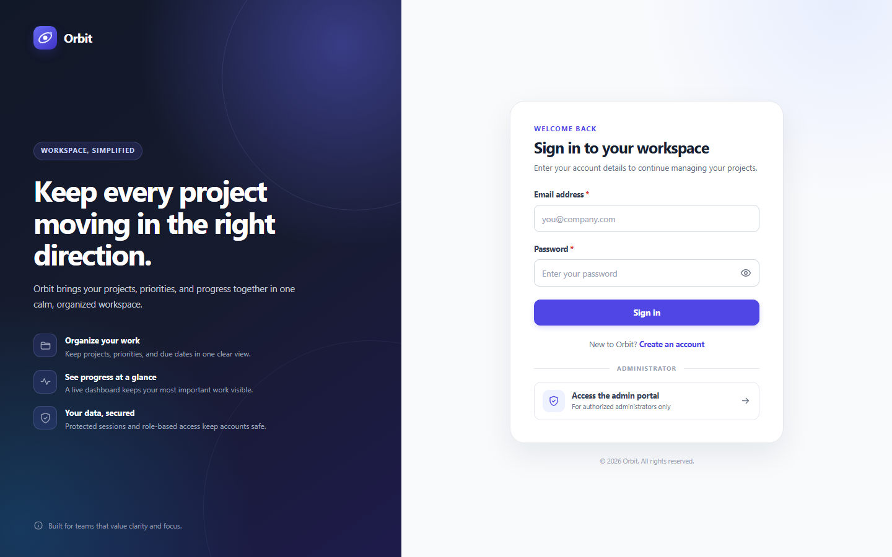 | 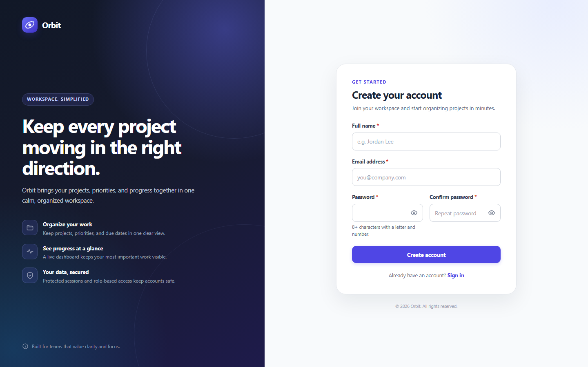 | 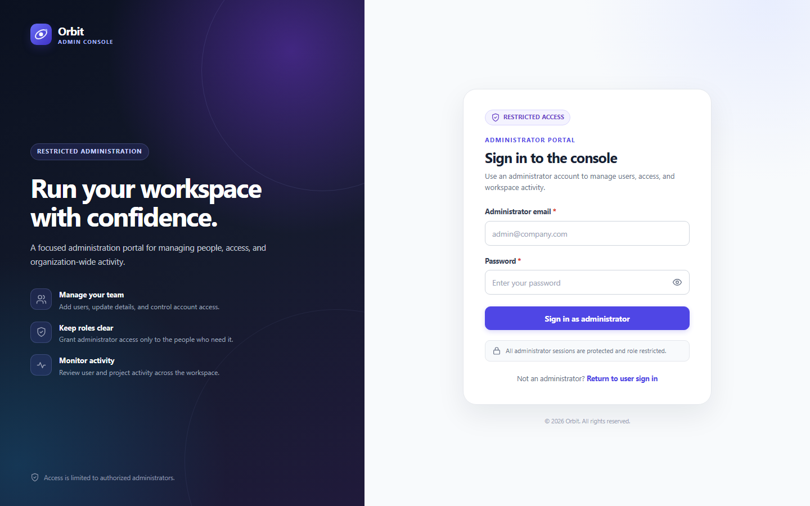 |

### User portal

| Dashboard | Projects |
| --- | --- |
|  | 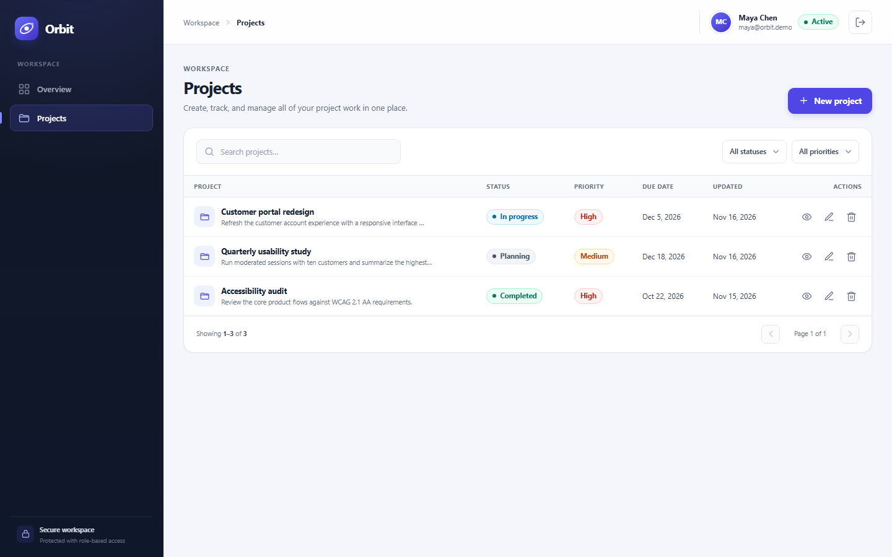 |

| Project details | Create / edit form |
| --- | --- |
| 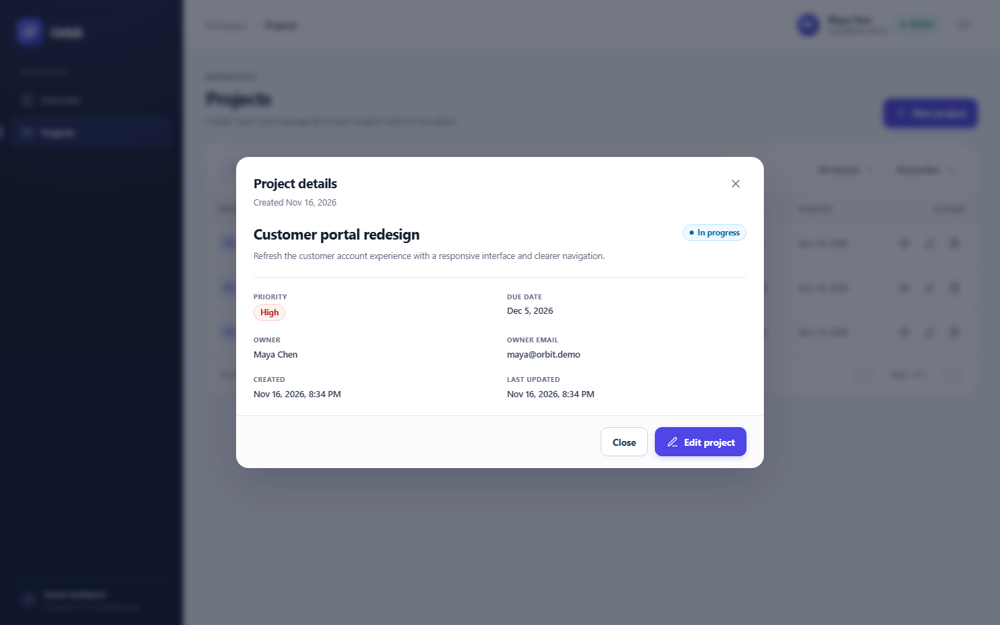 | 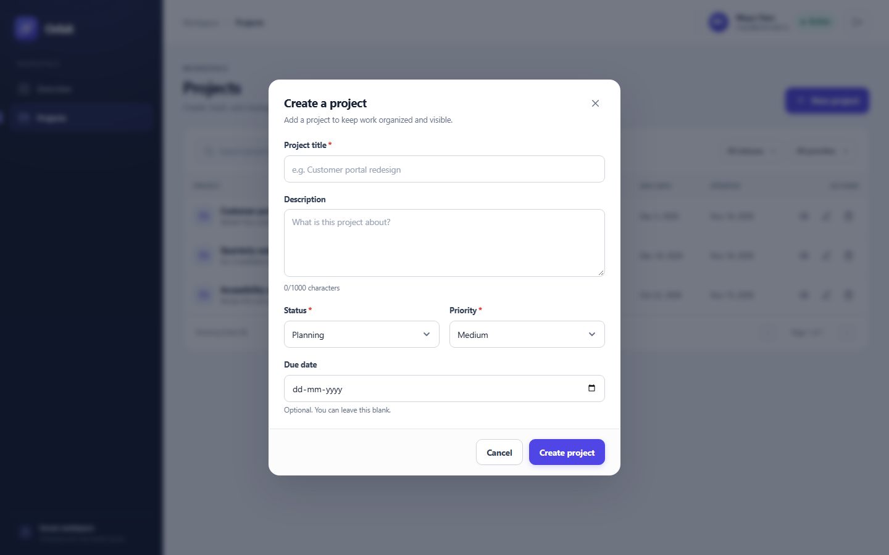 |

Mobile dashboard:

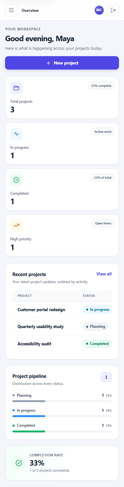

### Administrator portal

| Admin dashboard | User management |
| --- | --- |
| 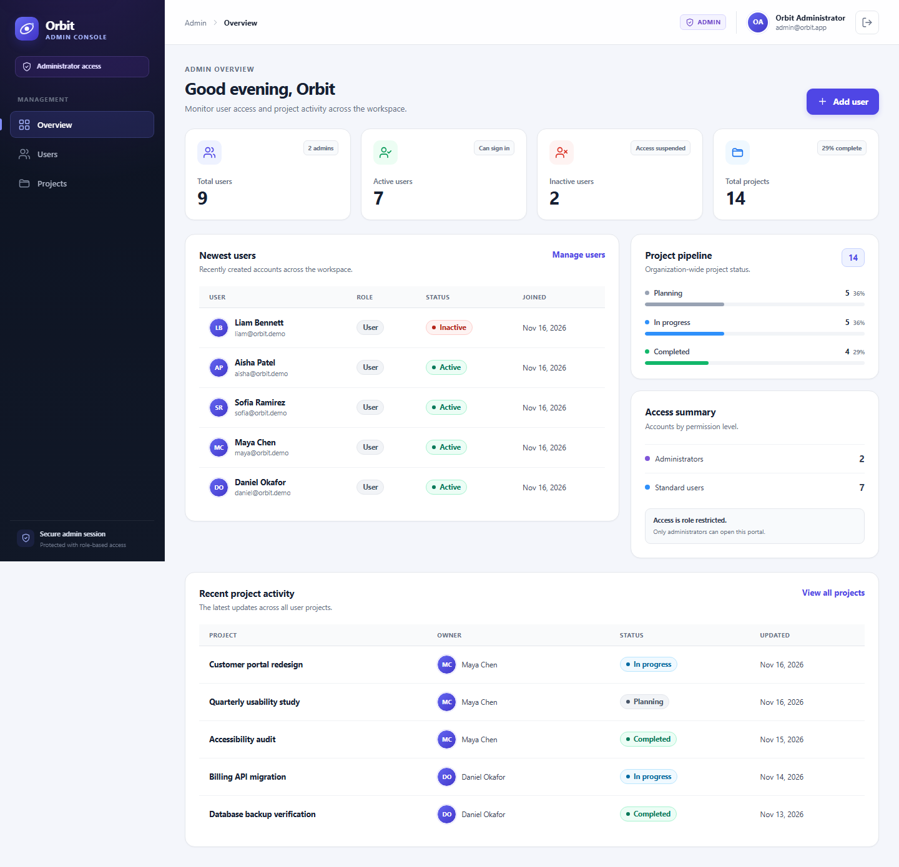 | 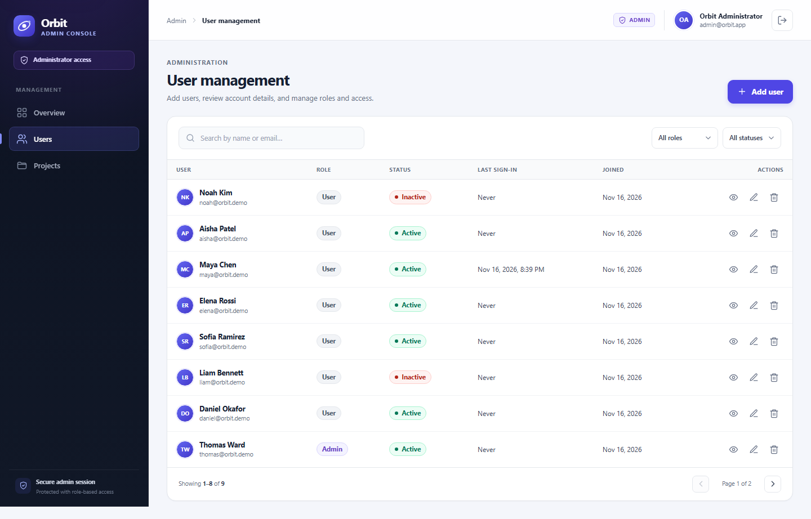 |

| User details | Add / edit user |
| --- | --- |
| 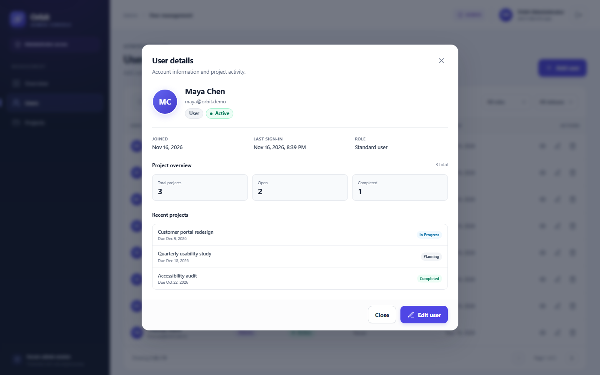 | 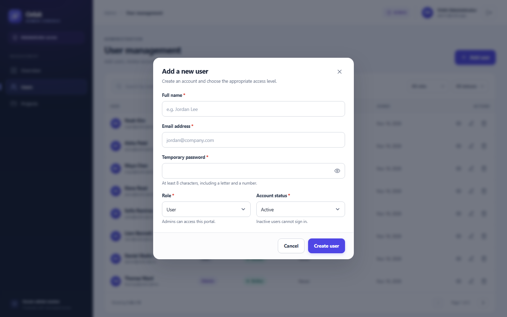 |

All projects:

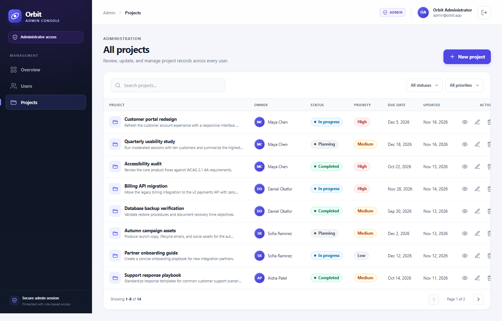

## Available scripts

| Location | Script | Description |
| --- | --- | --- |
| Root | `npm run install:all` | Install server and client dependencies |
| Root | `npm run dev` | Run API and Vite dev server together |
| Root | `npm run build` | Build the React app |
| Root | `npm start` | Start the Express server |
| Root | `npm test` | Run the server integration tests |
| Root | `npm run seed:admin` | Create or update the administrator |
| Root | `npm run seed:demo` | Create demo users and projects |
| Server | `npm run dev` | Start Express with nodemon |
| Server | `npm start` | Start Express |
| Server | `npm test` | Run integration tests |
| Client | `npm run dev` | Start Vite |
| Client | `npm run build` | Build for production |
| Client | `npm run preview` | Preview the production build |

## Security notes

- No secrets are committed. `.env` files are ignored; `.env.example` documents required values.
- Password hashes are never returned by the API.
- All write endpoints validate input on the server. Mongoose validation and duplicate-key errors are translated into consistent field errors.
- Project queries are scoped by owner unless the requester is an administrator.
- Admin routes are protected by both authentication and an explicit admin middleware.
- Deactivated users are rejected during login and on every subsequent authenticated request.
- Helmet sets security headers; CORS only allows configured origins and permits credentials.
- Rate limits reduce brute-force login and registration abuse.

## Troubleshooting

**`MONGODB_URI is not configured`** — create `server/.env` from `server/.env.example`.

**Cannot connect to MongoDB** — start `mongod` locally or use an Atlas URI. Local MongoDB usually listens on `127.0.0.1:27017`; `localhost` may resolve to IPv6 on some systems, so `127.0.0.1` is recommended.

**401 responses when signed out** — the app probes `/api/auth/me` on startup. A signed-out probe correctly returns `401`; this is expected.

**Login works in development but not production** — set `CLIENT_URL` to the deployed front-end origin, serve both sides over HTTPS, and keep `withCredentials` enabled (already configured).

**`mongodb-memory-server` download is slow** — use a local MongoDB test database with `TEST_MONGODB_URI` as described in [Testing](#testing).

**Admin cannot use the user portal** — this is intentional. Administrators are redirected to `/admin`, and user login rejects admin accounts.
